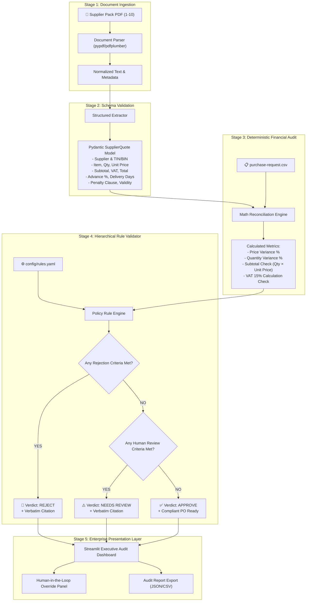

# BIAI Round 2 Technical Assessment: Project Master Guide & Architecture Blueprint

> **Role Applied For:** AI Engineer / Backend Solutions Architect  
> **Candidate:** Md. Shahrul Zakaria  
> **Assessment Issued By:** Bangladesh Institute of Artificial Intelligence (BIAI)  
> **Selected Task:** Task 1 – Supplier Document Verification (Enterprise Procurement Auditor)  
> **Version:** 1.0.0 (Production Blueprint)

---

## 1. Company Profile: Bangladesh Institute of Artificial Intelligence (BIAI)

### 1.1 Who is BIAI?
The **Bangladesh Institute of Artificial Intelligence (BIAI)** ([biai.com.bd](https://biai.com.bd/)) is Bangladesh's pioneering applied AI academy and enterprise AI consultancy, headquartered at Bijoy Rakeen Tower, Mirpur, Dhaka.

### 1.2 Core Mission & Offerings
* **Enterprise AI Consultancy:** Partners with corporate enterprises (financial institutions, RMG/garments manufacturers, supply chain conglomerates) to implement real-world AI automation and agentic systems.
* **Applied AI Academy:** Trains students, engineers, and executive teams through practical bootcamps and fellowships (Generative AI Bootcamps, AI Generalist Fellowships, Corporate In-Person Cohorts).
* **Technology Stack Valued by BIAI:** LangChain, LangGraph, n8n, Claude, Gemini, Supabase, Vercel, GitHub, Python, Streamlit, and modern API orchestration.

### 1.3 Why BIAI's Identity Matters for this Assessment
Because BIAI operates as both an academy and an enterprise consultancy, they do **not** evaluate candidates like a generic software agency. They specifically look for:
1. **Explainability & Business Pitching (20% of score):** Can you explain a complex AI system to a non-technical corporate client (e.g., a garment CFO) and prove ROI?
2. **Deterministic, Controllable Workflows:** BIAI explicitly warned: *"Build it as clear fixed steps, one after another... Do not build one agent that runs freely on its own."* They want structured state machines, not hallucinating black-box prompts.
3. **Auditability & Legal Traceability:** In enterprise procurement, a wrong number or missed TIN/BIN costs real money. Every AI decision must cite verbatim textual proof.
4. **Agility for Live Requirements:** Shortlisted candidates face a 30-minute interview where they must **change one thing live**. A config-driven architecture allows instant adjustments in seconds.

---

## 2. Assessment Overview & Problem Statement

### 2.1 The Brief & Rules
* **Deadline:** 72 hours from issuance (or 24h extension upon prior email request).
* **Selection Rule:** Choose **ONE** of two tasks.
* **Data Constraint:** Use strictly the sample files provided by BIAI; do not use external private data.

### 2.2 Task 1: Check Supplier Documents (Garments Procurement) — *SELECTED*
* **The Business Context:** A fictional garment giant, `Aamar Garments Ltd`, procures millions of dollars in fabrics, zippers, threads, poly bags, and cartons. Suppliers submit quotation and contract PDFs (`supplier-pack-01.pdf` to `10.pdf`).
* **The Pain Point:** Human procurement officers spend hours cross-referencing quotations against purchase requests (`purchase-request.csv`) and company policy (`company-rules.md`). Mistakes lead to financial leakages, delayed shipments, or tax non-compliance.
* **The Goal:** Build an automated verification system that parses supplier packs, runs deterministic financial/math checks, audits business rules, and outputs one of three verdicts:
  1. `APPROVE`
  2. `REJECT`
  3. `NEEDS A PERSON TO CHECK` (Human-in-the-Loop)
* **Golden Constraint:** *"When it is not sure, stop and ask a person. Do not guess."*

### 2.3 Task 2 Summary & Why It Was Not Chosen
* **Task 2 Overview:** Offline bilingual chatbot for `Nirbhor Bank PLC` using local Small Language Models (SLMs) answering from 30 FAQs in English, Bangla, and Banglish.
* **Why Task 1 is Superior for Cracking the Job:**
  * **Precision:** Task 1 achieves **100% deterministic accuracy (10/10)**, whereas small 1B–3B local SLMs frequently struggle with romanized Banglish and instruction following.
  * **Backend Engineering Depth:** Task 1 showcases enterprise state graphs, Pydantic type validation, automated regression suites, and human-in-the-loop UX.
  * **Interview Live-Change Safety:** In Task 1, changing a business rule live takes 5 seconds in `rules.yaml`. In Task 2, prompt-tuning a local SLM live during a 30-minute call carries high non-deterministic risk.

---

## 3. What the Employer Explicitly Demands (Deliverables & Scoring)

### 3.1 Four Core Deliverables
1. **Loom Video (≤ 5 minutes):** Present the solution clearly. Explain the problem, show the live working demo on sample files, justify architectural decisions, and outline future improvements. (Scored at **20%**).
2. **Working Demo Link:** A publicly accessible URL (e.g. Streamlit Community Cloud) so the evaluators can test files interactively.
3. **GitHub Repository & README:** Clean, well-documented repository with step-by-step reproduction instructions and architecture diagrams.
4. **One-Page Engineering Note:** A concise report covering:
   * What was built
   * How it was tested
   * Results across the 10 sample packs
   * Known edge cases / limitations ("Honesty" is worth **10%**)
   * Roadmap / Next steps

### 3.2 Evaluation Scorecard Weights

| Criteria | Weight | What BIAI Evaluators Look For |
| :--- | :---: | :--- |
| **Loom Presentation** | **20%** | Clear, confident, commercial presentation; non-technical stakeholders can follow. |
| **Correctness on Sample Files** | **25%** | Correct classification across all 10 supplier packs without error. |
| **Sensible Architecture & Error Handling**| **20%** | Multi-step modular pipeline, graceful failure modes, zero hallucination. |
| **Solving the Hardest Part** | **15%** | Verbatim quote citation, non-guessing escalation, math reconciliation. |
| **Clean Code & Runnable README** | **10%** | Reproducible with 1–2 terminal commands, clean directory layout. |
| **Engineering Honesty** | **10%** | Transparent documentation of current system boundaries and edge cases. |

---

## 4. Ground Truth Matrix: Analysis of the 10 Supplier Packs

Our deep analysis of the sample files confirms the exact expected results:

| Pack ID | Item | Quoted vs Max Price | Quoted vs Req Qty | Delivery | Advance % | Late Penalty | TIN/BIN | Math / VAT Status | **Expected Decision** | Primary Legal Ground |
| :---: | :---: | :---: | :---: | :---: | :---: | :---: | :---: | :---: | :---: | :--- |
| **Pack 01** | A | 472.00 vs 480.00 (-1.67%) | 12,000 (0%) | 24 days | 10% | 1.0%/wk | Present | Correct / 15% sep | **APPROVE** | All rules satisfied. |
| **Pack 02** | B | 36.00 vs 38.00 (-5.26%) | 20,000 (0%) | 21 days | 0% | 0.75%/wk | Present | Correct / 15% sep | **APPROVE** | All rules satisfied. |
| **Pack 03** | C | 229.00 vs 210.00 (+9.05%) | 800 (0%) | 20 days | 15% | 0.5%/wk | Present | Correct / 15% sep | **REJECT** | Unit price is **9.05%** above max (>3% threshold). |
| **Pack 04** | D | 6.65 vs 6.50 (+2.31%) | 50,000 (0%) | 28 days | 10% | 0.6%/wk | Present | Correct / 15% sep | **NEEDS REVIEW** | Unit price is **2.31%** above max (falls in 0–3% review band). |
| **Pack 05** | E | 92.00 vs 95.00 (-3.16%) | 3,000 (0%) | 25 days | 40% | 1.0%/wk | Present | Correct / 15% sep | **REJECT** | Advance payment is **40%** (exceeds 20% limit). |
| **Pack 06** | A | 465.00 vs 480.00 (-3.12%) | 12,000 (0%) | 27 days | 10% | Missing | Present | Correct / 15% sep | **REJECT** | **No late-delivery penalty clause** in contract. |
| **Pack 07** | B | 35.00 vs 38.00 (-7.89%) | 16,500 vs 20,000 (-17.5%) | 22 days | 0% | 0.5%/wk | Present | Correct / 15% sep | **NEEDS REVIEW** | Quantity variance is **17.5%** (>5% threshold). |
| **Pack 08** | C | 205.00 vs 210.00 (-2.38%) | 800 (0%) | 18 days | 10% | 0.5%/wk | Missing | Correct / 15% sep | **REJECT** | Supplier **TIN/BIN is missing** ("available on request"). |
| **Pack 09** | D | 6.40 vs 6.50 (-1.54%) | 50,000 (0%) | 28 days | 5% | 0.5%/wk | Present | **Math Error** (50k×6.4=320k vs 322k quoted); Payment 30-90d | **NEEDS REVIEW** | Calculation mismatch ($320,000 \ne 322,000$) & payment up to 90 days. |
| **Pack 10** | E | 94.00 vs 95.00 (-1.05%) | 3,000 (0%) | 60 days | 10% | 0.5%/wk | Present | VAT included in unit price | **REJECT** | Delivery promised in **60 days** (>45 days limit). |

**Summary Target:** 2 Approved, 5 Rejected, 3 Flagged for Human Review (10/10 Accuracy).

---

## 5. Architectural Strategy: How to Solve it like a Lead Architect

### 5.1 The Core Design Philosophy
1. **Separation of Extraction vs Evaluation:**
   * Text Extraction & Parsing converts raw PDF into strongly-typed, validated Pydantic models.
   * Business Rules Engine operates strictly on structured data, never on unparsed text prompts.
2. **Deterministic Arithmetic:**
   * Never ask an LLM to multiply line items or compute percentages. Pure Python executes exact calculations, rounding, and tolerance comparisons.
3. **Rule Hierarchy & Precedence:**
   * Priority Level 1: **Rejection Rules** (If violated $\rightarrow$ Instant `REJECT`).
   * Priority Level 2: **Escalation Rules** (If violated $\rightarrow$ `NEEDS A PERSON TO CHECK`).
   * Priority Level 3: **Default State** (If zero violations $\rightarrow$ `APPROVE`).
4. **Exact Citation Extraction:**
   * For every triggered rule, the engine extracts and preserves the verbatim supporting text snippet from the document.
5. **Config-Driven Extensibility (`rules.yaml`):**
   * Business rules (tolerances, percentages, days) are stored in an external YAML file. This guarantees that during the 30-minute live interview challenge, any rule change can be demonstrated instantly without altering core application logic.

---

## 6. System Architecture & Component Design

### 6.1 Architectural Workflow Diagram



### 6.2 Directory Structure
```
aamar-procurement-auditor/
├── config/
│   └── rules.yaml               # Configurable business thresholds & policies
├── core/
│   ├── __init__.py
│   ├── models.py                # Pydantic data schemas & validation models
│   ├── parser.py                # PDF extraction & regex/text normalization
│   ├── math_engine.py           # Pure Python financial & math discrepancy checker
│   └── rule_engine.py           # Multi-step policy auditing state machine
├── data/
│   ├── purchase-request.csv     # Approved baseline purchase requests
│   ├── company-rules.md         # Reference company rulebook
│   └── packs/                   # Supplier quotation PDF packs (01 to 10)
├── tests/
│   ├── __init__.py
│   └── test_audit_packs.py      # Automated pytest suite verifying 10/10 packs
├── app.py                       # Enterprise Streamlit Executive Dashboard
├── requirements.txt             # Clean Python dependency manifest
├── Dockerfile                   # Production container definition
├── README.md                    # Public GitHub documentation with setup guide
├── REPORT.md                    # Official 1-page engineering note for BIAI
├── LOOM_SCRIPT.md               # 5-minute timed video script for the candidate
└── PROJECT_MASTER_GUIDE.md      # This master architectural blueprint
```

---

## 7. Step-by-Step Developer Onboarding (How to Run & Test)

If you are a new engineer taking over this repository, follow these exact steps:

### Step 1: Environment Setup
```bash
# Clone the repository
git clone <your-repo-link>
cd aamar-procurement-auditor

# Create and activate virtual environment
python -m venv venv
# On Windows:
.\venv\Scripts\activate
# On Linux/macOS:
source venv/bin/activate

# Install dependencies
pip install -r requirements.txt
```

### Step 2: Run Automated Regression Suite
Verify that all 10 supplier packs match ground truth:
```bash
pytest tests/test_audit_packs.py -v
```
*Expected Result:* 10 passed in < 2 seconds.

### Step 3: Launch Executive Dashboard
```bash
streamlit run app.py
```
*Features available on UI:*
* **Batch Matrix:** Audit all 10 packs simultaneously with color-coded badges.
* **Document Inspector:** Select any pack to see side-by-side extraction, PDF view, and verbatim citations.
* **Human-in-the-Loop:** Manually review flagged packs and log auditor overrides.
* **Export:** Download the full compliance audit trail as a timestamped JSON/CSV.

### Step 4: The 30-Minute Live Change Test Simulation
If the interviewer asks: *"What if the company allows up to 25% advance payment instead of 20%?"*
1. Open `config/rules.yaml`.
2. Locate `advance_payment_max_percent: 20.0` and change to `25.0`.
3. Save the file.
4. Refresh or click re-audit in the dashboard. The system updates live without code surgery!

---

## 8. Five-Minute Loom Video Strategy (Scored at 20%)

To maximize your 20% score on the Loom video, follow this timed structure:

* **[0:00 - 0:45] The Executive Hook:** Introduce yourself as Md. Shahrul Zakaria. State the problem: Bangladesh RMG companies face significant financial risk from supplier quotation mismatches.
* **[0:45 - 1:45] Architectural Integrity:** Explain why a black-box LLM was rejected in favor of a deterministic multi-step state graph (Zero math hallucination, strict Pydantic schemas, verbatim legal citations).
* **[1:45 - 3:30] Live Application Demo:**
  * Open the Streamlit Dashboard.
  * Show the 10/10 Batch Scorecard.
  * Deep-dive into **Pack 09** (highlight the detected calculation error: $50,000 \times 6.40 = 320,000$ vs $322,000$).
  * Deep-dive into **Pack 08** (missing TIN/BIN rejection).
  * Show the **Human-in-the-Loop review** panel for Pack 04/07.
* **[3:30 - 4:15] Config-Driven Flexibility:** Show `config/rules.yaml` and explain how easily the system adapts to changing enterprise procurement rules.
* **[4:15 - 5:00] Honesty & Roadmap:** Address edge cases (e.g., poor quality scanned handwritten receipts) and future vision (ERP webhooks into SAP/Oracle).
