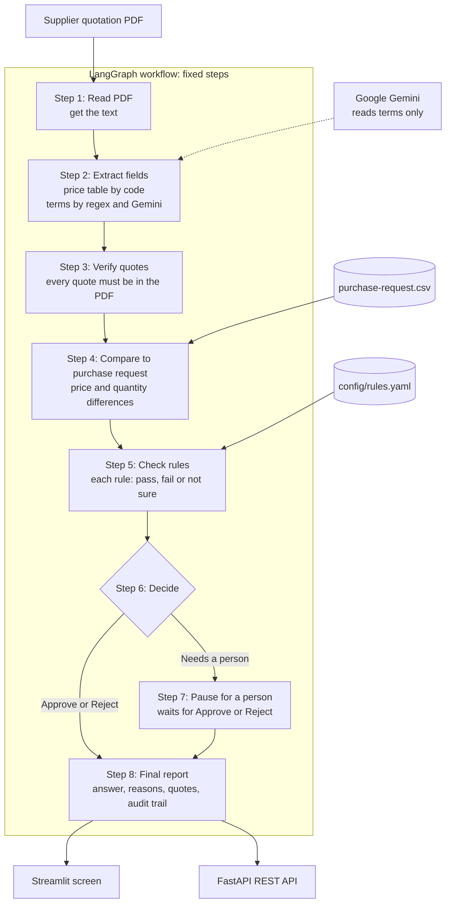
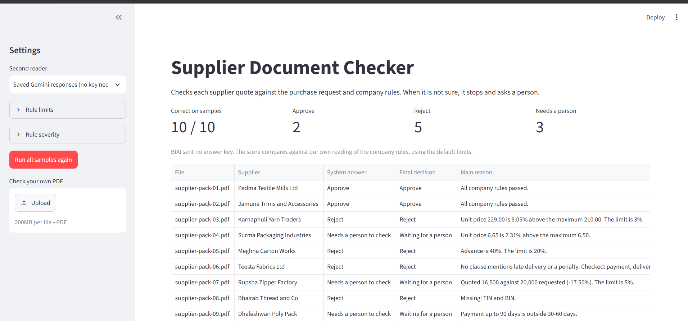
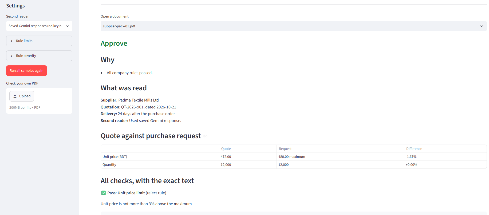
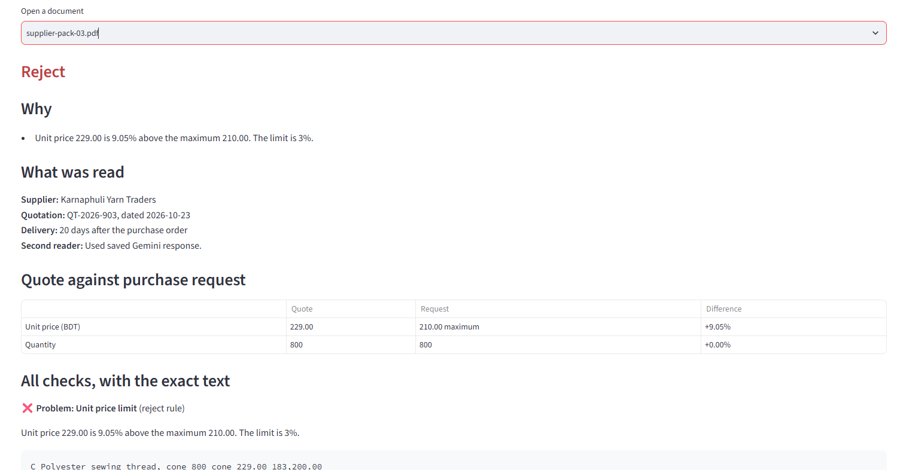
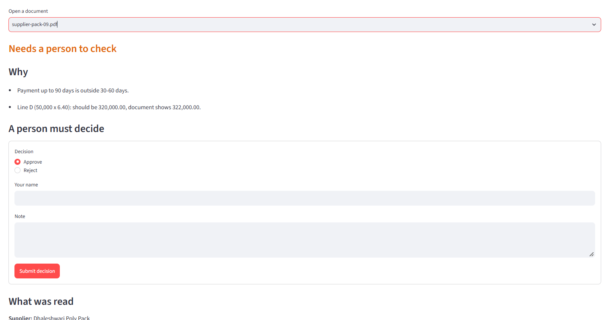

# Supplier Document Checker

An AI system that checks supplier quotations for a garment company, step by step, and never guesses.

**Live demo:** https://procurement-auditor.streamlit.app/

**How every part works, in plain words:** [docs/HOW_IT_WORKS.md](docs/HOW_IT_WORKS.md)

---

## The problem

Aamar Garments Ltd (fictional) buys fabric, zippers, thread, poly bags and cartons from many suppliers. Each supplier sends a quotation PDF with prices and contract terms.

Before a purchase is approved, a procurement officer has to check every quotation by hand:

- Does the price stay within the maximum the company approved?
- Is the quantity what was asked for?
- Are the payment, delivery and penalty terms within company rules?
- Is the supplier's TIN and BIN given?
- Do the numbers add up?

This is slow, and mistakes cost money. An overpriced line, a wrong total or a missing penalty clause can slip through.

## The solution

The system reads each quotation and gives one of three answers, with the reasons and the exact text from the document that proves them:

| Answer | Meaning |
|---|---|
| **Approve** | Every company rule passed. |
| **Reject** | At least one hard rule is broken, such as a price more than 3% over the maximum. |
| **Needs a person to check** | A softer rule is broken, or the system is not sure. It stops and waits for a person. |

The most important rule in its design is: **if the system is not sure, it asks a person.** It only approves when every check has positively passed. A value it could not read is never treated as a pass.

### How AI is used, and where it is not

- **Code does the math and makes the decision.** Prices, totals and VAT are checked with exact decimal arithmetic. Verdicts are chosen by fixed rules. AI never sets a verdict.
- **Two independent readers read the contract terms.** Strict pattern matching (regex) and Google Gemini each read the payment, delivery, penalty, validity and tax ID terms.
  - If they agree, the value is used.
  - If they disagree, a person checks.
  - If only Gemini can read a reworded clause, its reading is used only when its quote is found word for word in the document and contains the value.
- **Every quote is verified.** Any quote that is not really in the PDF is thrown out, so an AI answer cannot be made up.

## Results

On the 10 sample quotations from BIAI:

| Pack | Supplier | Answer | Main reason |
|---|---|---|---|
| 01 | Padma Textile Mills | Approve | All rules passed |
| 02 | Jamuna Trims and Accessories | Approve | All rules passed |
| 03 | Karnaphuli Yarn Traders | Reject | Price 9.05% over the maximum |
| 04 | Surma Packaging Industries | Needs a person | Price 2.31% over the maximum |
| 05 | Meghna Carton Works | Reject | 40% advance payment |
| 06 | Teesta Fabrics | Reject | No late-delivery penalty clause |
| 07 | Rupsha Zipper Factory | Needs a person | Quantity 17.5% below the request |
| 08 | Bhairab Thread and Co | Reject | TIN and BIN missing |
| 09 | Dhaleshwari Poly Pack | Needs a person | Line total wrong; payment up to 90 days |
| 10 | Kushiyara Box Industries | Reject | Delivery in 60 days |

**10 out of 10 correct**, measured three ways:

| Mode | Score |
|---|---|
| Regex only | 10/10 |
| Saved Gemini responses | 10/10 |
| Live Gemini, run 3 times | 10/10 each run |

BIAI did not send an answer key. These expected answers are our own reading of the company rules.

**Beyond the samples:** 118 automated tests cover exact rule limits, reworded clauses, broken files, Gemini failures and fake quotes. In 6 reworded clauses written for testing, regex alone sent all 6 to a person. With Gemini, 5 were answered correctly and 1 was correctly sent to a person. This is a small test set, so it shows the idea works but is not a general accuracy figure.

---

## Architecture

The workflow is a fixed sequence of steps built with **LangGraph**. There is no free-running agent: each step does one job and passes its result to the next.



**Deciding the answer:**

1. Any reject rule fails → **Reject**
2. Otherwise, any rule fails or is not sure → **Needs a person to check**
3. Every rule passes → **Approve**

**Tech stack:** Python 3.13, LangGraph, pdfplumber, Pydantic, Google Gemini (`google-genai`), Streamlit, FastAPI, pytest.

---

## Using the system

### 1. The dashboard



When the app opens, it checks all 10 sample packs straight away.

- **Top row:** the score on the samples and how many packs got each answer.
- **Table:** one row per document, with the system's answer, the final decision after any human review, and the main reason.
- **Sidebar, Second reader:** choose how contract terms are read:
  - **Saved Gemini responses:** the default. Needs no API key.
  - **Live Gemini:** calls Gemini.
  - **Regex only:** no AI.
- **Sidebar, Rule limits and Rule severity:** change any limit, or move a rule between Reject and Review, then press **Run all samples again**. Nothing in the code changes.
- **Sidebar, Check your own PDF:** upload any quotation to check it.

### 2. An approved quotation



Choose a document under **Open a document** to see its full report:

- **Answer and Why:** the verdict and the reasons for it.
- **What was read:** supplier, quotation number, date, delivery time, and which reader was used.
- **Quote against purchase request:** quoted price and quantity next to what the company asked for, with the difference in percent.
- **All checks, with the exact text:** every rule's result and the exact sentence from the PDF that supports it. Approvals are proven too, not just problems.

### 3. A rejected quotation



Pack 03 quotes 229.00 BDT per cone against a maximum of 210.00, which is 9.05% too high. The rule allows at most 3%, so the answer is **Reject**. The table row from the PDF is quoted as proof.

### 4. A person makes the decision



Pack 09 has two problems:
- **Wrong line total:** 50,000 × 6.40 should be 320,000.00, but the document says 322,000.00.
- **Payment terms:** payment "within 30 to 90 days" is outside the allowed 30 to 60 days.

The workflow **pauses** here. A person chooses Approve or Reject, enters their name and an optional note, and presses **Submit decision**. The workflow then finishes. The report keeps both the system's answer and the person's decision, so the audit trail shows who decided what.

Each report can be downloaded as JSON.

---

## Setup

You need Python 3.11 or newer. It was tested on Python 3.13.

```bash
git clone https://github.com/bringerofdarkness/procurement-auditor.git
cd procurement-auditor

python -m venv .venv
# Windows
.venv\Scripts\activate
# macOS / Linux
source .venv/bin/activate

pip install -r requirements.txt
```

**No API key is needed.** Saved Gemini responses for the 10 samples are included, so everything below works straight away.

### Run the app

```bash
streamlit run app.py
```

Open http://localhost:8501.

### Run the API

```bash
uvicorn api:app --reload
```

Open http://localhost:8000/docs to try every route in the browser.

| Method | Route | Purpose |
|---|---|---|
| `GET` | `/health` | Service check |
| `POST` | `/audits` | Upload a PDF and check it |
| `GET` | `/audits/{id}` | Get a report |
| `POST` | `/audits/{id}/review` | Give a person's decision |

Details and examples are in [docs/HOW_IT_WORKS.md](docs/HOW_IT_WORKS.md#8-the-rest-api).

### Run the tests

```bash
pytest -v                      # all 118 tests
python -m scripts.evaluate     # score on the 10 samples
```

`scripts.evaluate` uses saved Gemini responses by default. Add `offline` for regex only, or `live` for live Gemini.

### Use live Gemini (optional)

Copy `.env.example` to `.env` and add a free key from Google AI Studio:

```
GEMINI_API_KEY=your-key
LLM_MODE=live
```

On Streamlit Community Cloud, put `GEMINI_API_KEY` in the app's **Secrets** instead.

---

## Changing the rules

All limits and severities are in [config/rules.yaml](config/rules.yaml):

```yaml
limits:
  advance_max_percent: 20      # change to 25 and rerun

rules:
  - {id: tin_bin_missing, severity: reject, title: "Supplier TIN and BIN"}
  #                                ^ change to review
```

- **Change a limit or severity:** edit the YAML file, or use the app's sidebar.
- **Turn a rule off:** delete its line.
- **Add a new rule:** add a line to the YAML file and write one function in [core/rules.py](core/rules.py). See [docs/HOW_IT_WORKS.md](docs/HOW_IT_WORKS.md#11-how-to-change-the-system).

---

## Project structure

```
config/rules.yaml          Company rule limits and severities
core/
  models.py                Data shapes passed between steps
  pdf_reader.py            Step 1: read text from the PDF
  extractors.py            Steps 2-3: read fields, merge readers, verify quotes
  llm.py                   Gemini reader, with live, replay and offline modes
  purchase_request.py      Step 4: compare with the purchase request
  math_checks.py           Exact arithmetic checks
  rules.py                 Steps 5-6: every rule, and the final decision
  graph.py                 The LangGraph workflow and its entry functions
app.py                     Streamlit screen
api.py                     FastAPI routes
data/
  expected_verdicts.json   Our expected answers for the 10 samples
  llm_responses.json       Saved Gemini responses for replay mode
scripts/
  evaluate.py              Print the score on the samples
  record_llm_responses.py  Save new Gemini responses
task1-procurement/         Sample files from BIAI, unchanged
tests/                     118 automated tests
docs/                      Full explanation and screenshots
```

---

## Design decisions

| Decision | Why |
|---|---|
| Fixed LangGraph steps, not a free agent | BIAI asked for clear fixed steps. Each step can be tested alone, and the workflow can pause for a person. |
| AI reads, code decides | AI can misread or make up values. Math and verdicts must be exact and repeatable. |
| Two readers that must agree | A disagreement is a strong sign something is unclear, so it goes to a person. |
| Three states per rule: pass, fail, not sure | A missing value must never count as a pass. "Approve" needs proof for every rule. |
| "Absent" is different from "unreadable" | A penalty clause that is clearly missing is a Reject. One that exists but cannot be read goes to a person. |
| Rules in a YAML file | A business rule change does not need a code change. |
| Saved Gemini responses | Anyone can run and test the system without an API key, and results are repeatable. |
| Decimal arithmetic | Avoids rounding errors at exact limits, such as a price exactly 3% over. |

---

## Known limitations

- **Reworded clauses:** regex only understands common wording. Unusual wording goes to a person unless Gemini can read it and prove it with an exact quote.
- **A misled Gemini:** if regex cannot read a clause and Gemini is misled by text hidden in the document, a wrong value could be used. Gemini read the real value in all 6 attempts at this, but it cannot be ruled out.
- **Scanned PDFs** have no text, so they always go to a person. There is no OCR yet.
- **Hidden text** in a PDF, such as white text, is read like normal text.
- **One item per quotation:** quotes with several items, or a different table layout, go to a person.
- **No PO date** is in the documents, so delivery is reported as days after the PO, not as a date.
- **Our reading of the rules:**
  - "Within 30 days of delivery" counts as inside the 30 to 60 day rule.
  - A penalty that does not say "of order value" goes to a person.
- **Storage:** audits are kept in memory, so they are lost when the app restarts.
- **Privacy:** in live mode, the document text is sent to Google. That is fine for these fictional samples, but real supplier data would need a private model or a data agreement.

## Next steps

1. **Saved history:** store audits and decisions in a database, for example with a LangGraph Postgres checkpointer.
2. **OCR** for scanned quotations.
3. **More layouts:** support quotations with several items and other table layouts.
4. **More test data:** test with real (anonymised) quotations to measure accuracy properly.
5. **Access control:** add login, so only authorised staff can approve.
6. **ERP integration:** send approved quotations straight to the company's purchasing system through the API.

---

All companies and documents in this project are fictional sample data supplied by BIAI.
